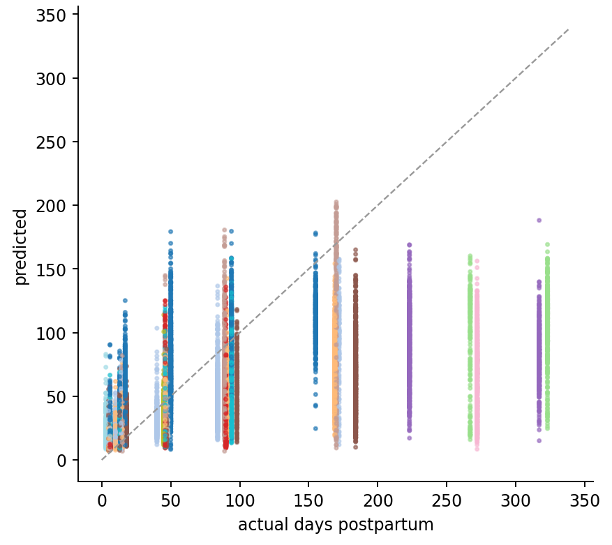
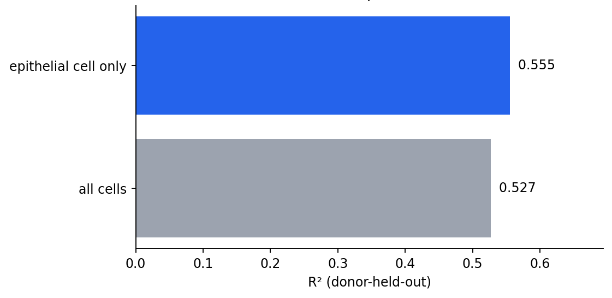
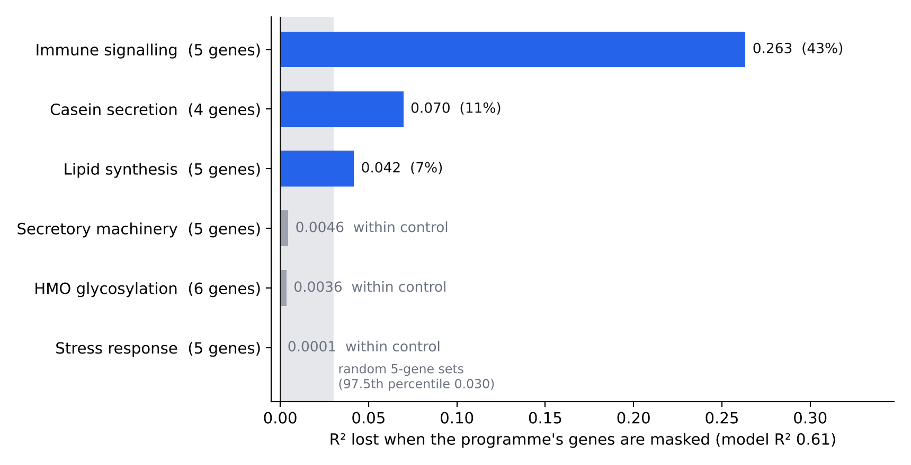
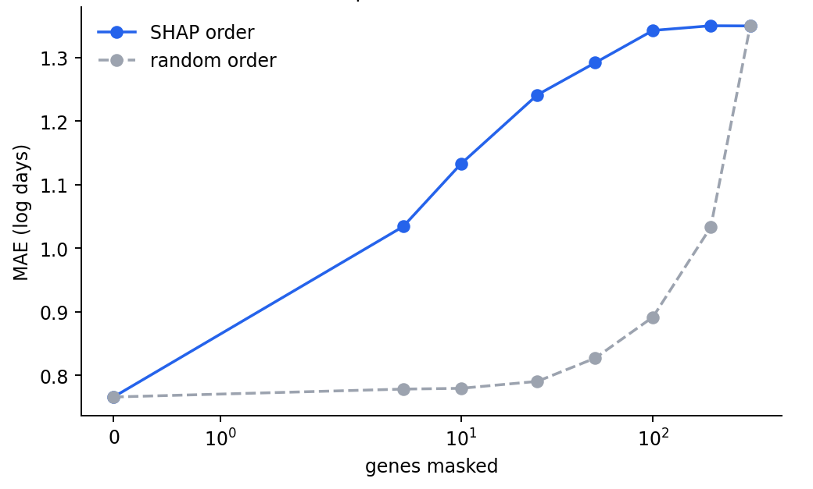

# LactoXAI

**A lactation clock from human milk single-cell transcriptomes, with explanations that are tested before they are believed.**

A random forest predicts days postpartum from a single milk cell's gene expression. It is validated on mothers it has never seen, and every explanation is checked for faithfulness and against a model trained on shuffled labels.

**[Interactive site](https://rishabhjha1.github.io/LactoXAI/)** · **[Knowledge base](https://rishabhjha1.github.io/LactoXAI/kb/)** · **[Report (PDF)](docs/LactoXAI_report.pdf)** · **[Notebook](notebooks/LactoXAI.ipynb)**

The **knowledge base** turns the results into linked, checkable claims: explore any gene or programme, see a graph that places genes between early and later lactation, follow mechanisms as step-by-step semantic chains with their weak links marked, read the contested claims, and check a scorecard for every question. Every link carries a 0–5 trust score from the checks it passed.

## Headline results

| Question | Result | Verdict |
| --- | --- | --- |
| Is lactational time readable from milk cells? | R² 0.53 on held-out mothers (folds 0.38–0.64); best of 20 sample-level permutations −0.04 | Supported |
| Is it more than recognising the mother? | Leaky random split 0.63 vs held-out 0.53; mother identified 62% vs 16% chance | Supported |
| Is it more than a change in cell mix? | Epithelial cells only: R² 0.56 (folds 0.08–0.67) | Supported; one fold weak |
| Do the explanations reflect the model? | Masking the top 5 SHAP genes: error 0.77 → 1.03 (random 5: 0.78); shuffled-label model r = 0.25 | Supported |
| Does unsupervised NMF find the same genes? | 17 of the top 25 SHAP genes fall in 4 epithelial NMF programmes (about 1 expected at random) | Supported |
| Which curated programmes carry the clock? | Immune 0.26, casein 0.07, lipid 0.04 R² lost; random 5 genes ≤ 0.03 | 3 of 6 |
| Do programme averages work as features? | R² 0.15 vs 0.48 for individual genes | Weak |
| Can it resolve late lactation? | Only 3 mothers sampled after 200 days; under-predicted past ~150 days | Not supported |

Two epithelial programmes carry the clock. **Early milk:** SFRP1, KRT15, HLA-DRA, CD74, C3 (progenitor-like epithelium with MHC-II and complement). **Later milk:** KRT80, ANXA2, CLDN4 (junctional epithelium) and the secretory genes CSN2, CSN3, LALBA, BTN1A1. HPGD has the largest single effect.

| | |
| --- | --- |
|  |  |
| Days postpartum predicted for held-out mothers (R² 0.53). | The clock holds inside epithelial cells alone (R² 0.56). |
|  |  |
| Immune, casein and lipid programmes beat a random-gene control. | Masking SHAP's top genes degrades the model far faster than random genes. |

## Data

Single Cell Portal **[SCP1671](https://singlecell.broadinstitute.org/single_cell/study/SCP1671)**: Nyquist SK, …, Shalek AK, Berger B, Goods BA. *Cellular and transcriptional diversity over the course of human lactation.* PNAS 119:e2121720119 (2022).

The paper follows 15 mothers for up to 632 days. In the public metadata, cells from 13 of them carry a timepoint, between days 3 and 323; this analysis uses that subset (42,824 cells, 25,000 sampled for modelling).

## Run it

**Kaggle (easiest):** upload the SCP1671 folder as a dataset, attach it to a notebook, open `notebooks/LactoXAI.ipynb`, run top to bottom.

**Locally:** download SCP1671 into `./data/`, then

```bash
pip install -r requirements.txt
jupyter lab notebooks/LactoXAI.ipynb
```

Install packages **before** starting the kernel. Installing into a running kernel can leave numpy half-upgraded. The first run streams a ~7 GB text matrix once and caches an `.h5ad`; later runs take about 30 minutes, most of it the 20 permutations.

Outputs: `figures/F*.png`, `results/results.json`, `results/nmf_programs.json`, `results/F17_counterfactuals.csv`, `results/shap_values.npy` with `shap_gene_names.json`.

## Repository layout

```
notebooks/LactoXAI.ipynb   full pipeline: load → QC → clock → trust tests → XAI → NMF
results/                   numbers from the run shown here
figures/                   the figures used in the report and site
scripts/redraw_f16.py      rebuilds the ablation chart from results.json
scripts/build_site.py      rebuilds docs/index.html from results/
scripts/build_kb.py        rebuilds docs/kb/index.html from results/
docs/                      GitHub Pages site, knowledge base (docs/kb/) and PDF report
```

## Limits

- Late lactation rests on three mothers; the clock does not resolve months 6–11.
- Time and mother are confounded by design (a median of one mother per timepoint). Donor-held-out validation limits this but cannot remove it.
- Mitochondrial genes push predictions later but vary by mother, so they may reflect sample quality.
- p ≤ 0.048 is the floor for 20 permutations.
- One observational cohort. No result is a causal claim about any gene, and nothing here bears on medication use by anyone.

## Author

Rishabh Jha · MSc Computer Science, University of Victoria (Medical Computer Vision Lab)

Licence: MIT (code). The data belong to their authors; see SCP1671 for its terms.

## Rebuilding the site after a new run

Copy the new `results.json`, `nmf_programs.json` and `F17_counterfactuals.csv` into `results/`, then from the repo root:

```bash
python scripts/build_site.py . scripts/LactoXAI_site_template.html
python scripts/build_kb.py   . scripts/kb_template.html
```

Every number on both pages is read from those files, so the site cannot drift from the analysis.
